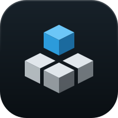

# Brand

The logo is a clone as four equal cubes, its worktrees, set in a square. The back cube has
been lifted straight out and floats in blue above the notch it leaves: the worktree whose
work has merged, on its way out. reap sweeps up those worktrees and leaves the rest of the
clone standing (ADR 0001).

It shares faber's and git-tether's construction (isometric cubes on the same 29-unit
footprint, one shell colour at several strengths, one accent set apart by a cut, a dark tile
with a light rim), so the three read as one family. Each carves it differently, so they stay
apart in the menu bar: faber's core sits flush in the front corner of a tall cube, tether
raises a disc on a ring and layers its sides, and reap is a low slab with a gap at the back
and a cube above it.

## Geometry

All on a 100-unit tile, in 2:1 isometric (edges step two across for one down, so they land on
whole pixels at small sizes). `scripts/generate-mark.mjs` holds the values; change them there.

| Part | Master | Tray |
|---|---|---|
| Tile, corner radius | 100, r 22.5 (Apple's icon grid) | none |
| Footprint | a square of side 29; its outline is 58 wide | side exactly 16px on 36px |
| Cut between the cubes | 3 | 3.6 (about 2px) |
| Cubes | four, each side (29 − cut) / 2; the back one lifted | the same |
| Lift (gap under the lifted cube) | one cut, so every gap in the mark is the same | the same |
| Centring | the whole mark, lifted cube included, on (50,50) | the same |

Every cut is a gap between shapes, not a mask: AppKit rasterises masks coarsely.

## Files

| File | What |
|---|---|
| `docs/brand/logo.svg` | The master: the mark on its tile, in colour. |
| `docs/brand/glyph-mono.svg` | One colour, no tile; black, white in dark mode. |
| `app/icons/src/app-icon.svg` | The master inside Apple's canvas margin (tile at 824 of 1024). |
| `app/icons/src/tray-*.svg` | The menu-bar icon in its three states, on the tray geometry. |
| `app/icons/*.png`, `icon.icns`, `app/icons/tray/*.png` | Rendered output; the app bundle and `tray.rs` use these. |

`scripts/render-icons.sh` runs the generator, then renders every PNG from the SVGs. Commit the
generator, the SVGs and the PNGs together.

## Menu-bar icon

- **States** (ADR 0001 rule 15): *tidy* is the mark; *removal pending* is the three cubes in
  outline round the notch with the lifted cube still filled, also shown before the first
  report; *needs you* is the whole mark in orange.
- *Tidy* and *removal pending* are template images: black on transparent, so macOS tints them
  for light, dark and highlighted menu bars. *Needs you* is not a template, so it keeps its
  colour. Its lifted cube is orange too: it floats clear of the others, so a white one would
  vanish on a light menu bar.
- The tray is redrawn on its own geometry, not the master scaled down: scaled, the cuts close
  up at 18pt and the lifted cube sticks out of the canvas.

## Colour

- The tile is a blue-black (`#172129` to `#0A0F13`) with a light rim along its top edge; the
  shell is one cool white (`#EAF1F6`) at several strengths: the tops 0.95, the left plane 0.74
  then 0.6 on the front cube, the right plane 0.44 then 0.32.
- The lifted cube is the only colour: an azure (`#6CC6F7` on top, `#2C9BDB` left, `#1B6A9E`
  right). It is lighter and more cyan than tether's cornflower (`#5B9DF5`) on a darker, less
  navy tile, so the two stay apart in the Dock; in the menu bar the shapes do that, since both
  tray icons are one colour.
- One colour (the glyph and the tray) is lit from the side, the tops on the middle step (shell
  0.38 / 0.55 and 0.47 / 0.24 and 0.19, lifted cube 0.78 / 1 / 0.56): the same alphas are dark
  on a light background and bright on a dark one, so a top-lit mark would look lit from below
  on light.
- Orange means *needs you*, in the tray and in the popover, so the app icon stays out of it.
