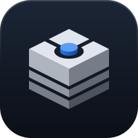

# Brand

The logo is a cube, the clone, with the tether cut into its top: a ring on two cords holding a
raised blue core, the branch it is kept on. Its sides are cut into layers that darken downwards,
the history under that branch.

## Geometry

All on a 100-unit tile, in 2:1 isometric (edges step two across for one down, so they land on
whole pixels at small sizes). `scripts/generate-mark.mjs` holds the values; change them there.

| Part | Master | Tray |
|---|---|---|
| Tile, corner radius | 100, r 22.5 (Apple's icon grid) | none |
| Cube | edge 29, centred on (50,50); its outline is a hexagon from 21 to 79 | edge exactly 16px on 36px |
| Ring (top face, fractions of the edge) | centre 0.56, radius 0.26, cords 0.1 wide | centre 0.52, radius 0.36, cords 0.16 wide |
| Core | radius 0.155, raised 3 | radius 0.17, raised 3.5 |
| Side layers (fractions of the edge) | 0–0.431, 0.517–0.707, 0.793–1 | 0–0.55, 0.68–1 |

Every cut is a gap between shapes, not a mask: AppKit rasterises masks coarsely.

## Files

| File | What |
|---|---|
| `docs/brand/logo.svg` | The master: the cube on its tile, in colour. |
| `docs/brand/glyph-mono.svg` | One colour, no tile; black, white in dark mode. |
| `app/icons/src/app-icon.svg` | The master inside Apple's canvas margin (tile at 824 of 1024). |
| `app/icons/src/tray-*.svg` | The menu-bar icon in its three states, on the tray geometry. |
| `app/icons/*.png`, `icon.icns`, `app/icons/tray/*.png` | Rendered output; the app bundle and `tray.rs` use these. |

`scripts/render-icons.sh` runs the generator, then renders every PNG from the SVGs. Commit the
generator, the SVGs and the PNGs together.

## Menu-bar icon

- **States** (ADR 0001 rule 11): *in sync* is the cube, *syncing* is the cube as a wireframe
  around its core, *needs you* is the cube in orange with a white core.
- *In sync* and *syncing* are template images: black on transparent, so macOS tints them for
  light, dark and highlighted menu bars. *Needs you* is not a template, so it keeps its colour.
- The tray is redrawn on its own geometry, not the master scaled down: scaled, the ring and the
  layer gaps close up at 18pt. Its cuts open to about 2px at 36px.

## Colour

- The tile is navy (`#1C2636` to `#0B0F17`) with a light rim along its top edge; the shell is one
  cool white at three strengths (top 0.95, left 0.72 down to 0.48, right 0.46 down to 0.28).
- The core is the only colour: the accent blue (`#5B9DF5` on top, `#2A74E0` to `#16479A` round
  its side).
- One colour (the glyph and the tray) is lit from the side, the top on the middle step: the same
  alphas are dark on a light background and bright on a dark one, so a top-lit cube would look
  lit from below on light.
- Orange means *needs you*, in the tray and in the popover, so the app icon stays out of it.
